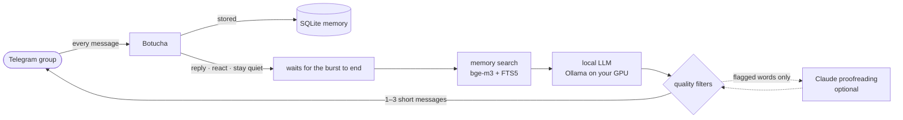

<div align="center">

# Botucha

**A Telegram group bot with a personality, a long memory, and nothing in the cloud.**

He talks like one of your friends, remembers what the group says, learns its slang,
knows who is who, and runs entirely on your own PC.


-000000?logo=ollama&logoColor=white)


</div>

---

## ✨ Highlights

- **A member, not an assistant.** Short lowercase messages in the group's own slang (Lithuanian in the
  example), dry and sometimes dark humor. The persona is one text file you edit.
- **Knows when to talk.** Always answers when called; sometimes jumps in on keywords or at random; waits for
  a burst of messages to end and answers it once; `/tyla` makes him quiet.
- **Memory that grows.** Every message is kept and searchable. Facts, slang and member profiles are learned
  while the chat is quiet, and members can teach him directly.
- **People and relations.** Members and friends are known by every name and word form, and linked to the
  facts that mention them and to each other (`Jonas – boss → Petras`).
- **Sees photos and checks prices.** He looks at a photo he replies to and remembers it; tickers come up with
  live prices from Yahoo, and he never invents numbers.
- **Clean output.** A hunspell check catches invented words, plus filters for repeats, persona leaks and
  stray scripts. Claude can optionally proofread flagged words.
- **Hardened.** No tools at all, memory passed as data, instruction-like memory refused, per-user rate
  limit, unknown groups left at once. A restart or crash never drops a reply.
- **A local dashboard.** Charts, a step-by-step graph of how every reply was made, memory and people
  editing, ratings, controls and settings, in English or Lithuanian.

## 🧭 How it works



The details, rules and reasons for each step are in **[docs/how-it-works.md](docs/how-it-works.md)**.

## 🚀 Quick start

**You need** a Linux PC with an NVIDIA GPU (developed on 16 GB VRAM), [Ollama](https://ollama.com),
[uv](https://docs.astral.sh/uv/), `hunspell` (optional) and a bot token from [@BotFather](https://t.me/BotFather).
In BotFather, run `/setprivacy` → your bot → **Disable**, so he can read the group.

```bash
git clone git@github.com:<you>/botucha.git && cd botucha
uv sync
ollama pull bge-m3                      # memory search (runs on CPU)

cp .env.example .env                    # BOTUCHA_TOKEN=...
cp config.example.toml config.toml      # chat_ids, admin_id, chat_model
cp persona.example.md persona.md        # who he is
chmod 600 .env config.toml

uv run python -m botucha --config config.toml
```

Don't know your group's ID? Start him and write in the group: the log prints `ignoring chat -100…`. Add it
to `telegram.chat_ids` and re-add him.

> [!TIP]
> Point `paths.export` at a Telegram Desktop export (`result.json`, JSON format, no media) and he learns the
> group's history on first start.

### Run it as a service

```bash
mkdir -p ~/.config/systemd/user
ln -sf "$PWD/deploy/botucha.service" "$PWD/deploy/botucha-web.service" ~/.config/systemd/user/
cd web && npm ci && npm run build:static && cd ..   # builds the dashboard UI
systemctl --user daemon-reload
systemctl --user enable --now botucha botucha-web
loginctl enable-linger "$USER"                      # keep running when logged out
```

The units assume `~/Projects/botucha` and uv from mise; edit `WorkingDirectory` and `ExecStart` if yours differ.
The dashboard is at **http://127.0.0.1:8765**.

## 💬 Commands

| Everyone | |
|---|---|
| mention, reply to, or name him | he answers |
| `/rimtai <question>` | a straight, factual answer |
| `/isimink <fact>` · `/slengas <word> = <meaning>` | teach him a fact or slang |
| `/ka_zinai [name]` | what he knows about someone |
| `/atsimeni <topic>` | find an old conversation, with links |
| `/kaina <ticker>` | live price, instantly |
| `/tyla [min]` | no uninvited replies for a while |
| `/gerai` · `/blogai [why]` · `/pataisyk <better reply>` (as a reply to him) | rate or correct a reply |

<details>
<summary><b>Admin commands</b></summary>

| | |
|---|---|
| `/pamirsk <nr>` · `/taisyk <nr> <text>` | delete or correct a fact |
| `/zmogus Name = nick1, nick2` | add a person with nicknames and word forms |
| `/rysys A > relation > B` · `/rysys` · `/rysys trink <nr>` | add, list or delete relations |
| `/daznis <n>` | uninvited replies about 1 in n messages |
| `/isjunk` · `/ijunk` | off (still listens) / on |
| `/statusas` · `/ivertinimai` | status, ratings and corrections |

</details>

## 🔒 Privacy

- **Stays on your PC:** the model, the embeddings and the database. Private files (`botucha.db`, `.env`,
  `config.toml`, `persona.md`, backups) are git-ignored and mode 600.
- **Leaves it:** Telegram sees the messages, as with any bot. Yahoo sees the tickers he looks up. With
  proofreading on, Anthropic sees his own flagged drafts and words, never the chat.
- **Retention:** he keeps every message. Telegram's auto-delete does not touch his memory. Tell your group.
- **Backups** are made daily. Restore with `python -m botucha.restore`, never by copying the file
  ([why](docs/how-it-works.md#backups-and-restore)).

## 🛠 Development

```bash
uv run pytest                                                       # no Telegram, Ollama or GPU needed
cd web && npm run check && npm run test:i18n && npm run test:unit   # lint, translations, layouts
cd web && npm run build:static && npm run test:e2e                  # Playwright on a seeded test server
```

## ❓ Troubleshooting

| Symptom | Fix |
|---|---|
| He never answers in the group | The chat ID is missing from `chat_ids` (see the log), or privacy mode is still on: disable it and re-add him. |
| "servas perkaito, palauk" | Ollama is down or the model failed: check `/statusas` and `journalctl --user -u botucha`. |
| Reactions do nothing | He has to be a group admin to see reactions. |
| He invents words | Lower `temperature`, teach words with `/slengas`, or approve them on the Quality page. |
| He ignores photos | The log says `vision: no`: attach the model's mmproj ([how](docs/how-it-works.md#images)). |
| Dashboard says "UI not built" | `cd web && npm ci && npm run build:static` |

---

<div align="center">
<sub>Full reference: <a href="docs/how-it-works.md">how it works</a> · config: <a href="config.example.toml">config.example.toml</a> · persona: <a href="persona.example.md">persona.example.md</a><br/>
MIT licensed, see <a href="LICENSE">LICENSE</a>. The bundled Lithuanian dictionary keeps its own BSD licence.</sub>
</div>
